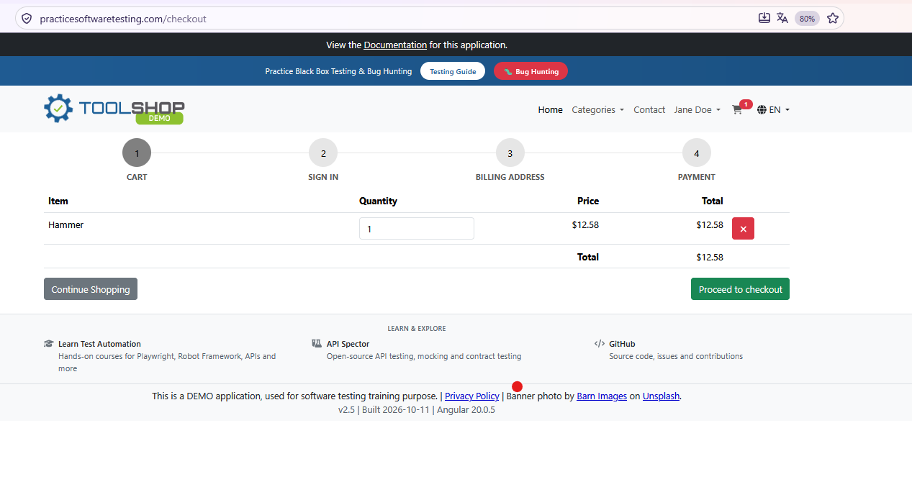
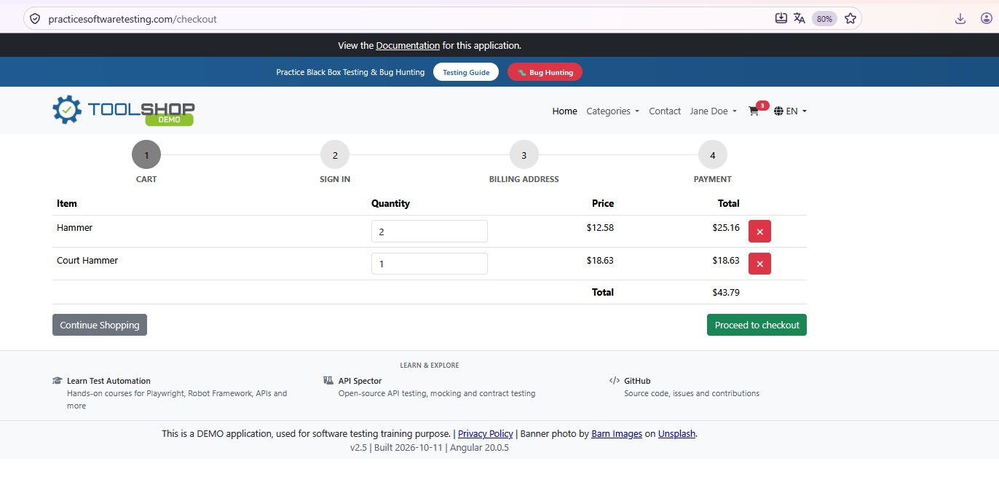
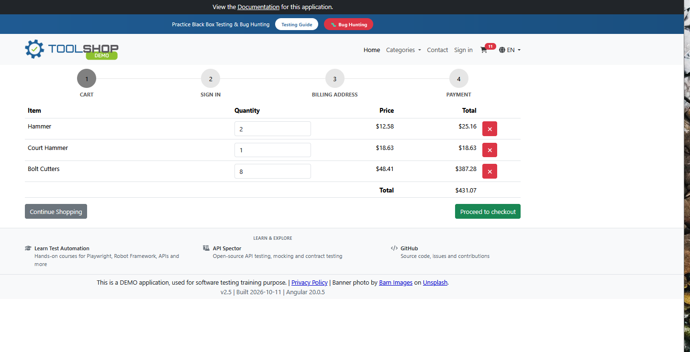
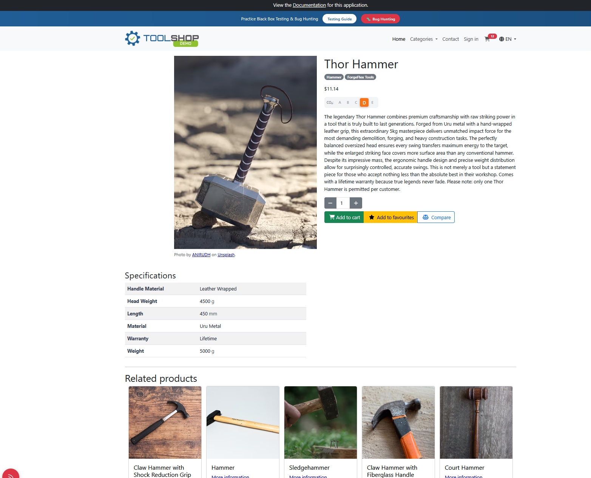
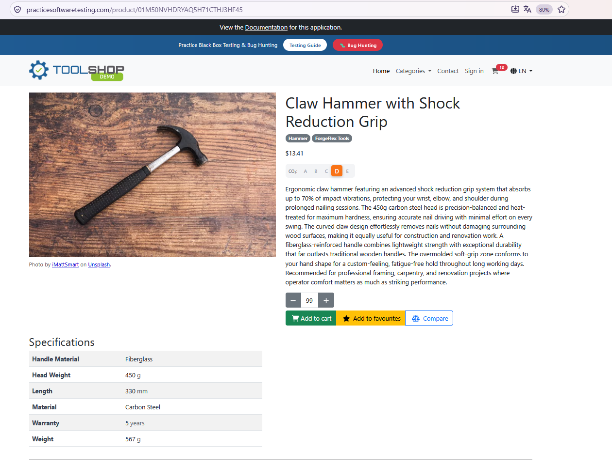

# Apply Exploratory Testing on Toolshop – Add Products to Shopping Cart

## Reference to ISTQB Syllabus Chapter

ISTQB FL – 4.4.2 Exploratory Testing

## Link to the Transfer Task File

[Apply Exploratory Testing on Toolshop](https://github.com/JulietaTz/RBI-AgileEngineeringFoundation/blob/main/courses/TestBusters-LearningLab/ISTQB-2026/foundationLevel/transferTasks/Chapter%204/ISTQB-FL-4.4.2_Exploratory_Testing_20260405.md)

---

## Outcome

### 1. Test Context

| Attribute | Description |
|---|---|
| Application | [Toolshop](https://practicesoftwaretesting.com/) |
| Feature | Add Products to Shopping Cart |
| Application Version | v2.5 |
| Reference Release | Sprint 5 |
| Testing Technique | Exploratory Testing |
| Test Approach | Session-Based Exploratory Testing |
| Test Type | Functional and Usability Testing |
| Browser | Mozilla Firefox |
| Execution Date | 15.10.2026 |
| Planned Session Timebox | 15 minutes |

**Documentation References:**

- [Toolshop Documentation](https://github.com/testsmith-io/practice-software-testing/tree/main/docs)
- [Toolshop Sprint 5](https://github.com/testsmith-io/practice-software-testing/tree/main/sprint5)

---

### 2. Requirement Reference and Test Oracles

#### 2.1 Documented Expected Behavior

**Reference:**

[Toolshop GitHub Issue #822 – Add to Cart button does not work](https://github.com/testsmith-io/practice-software-testing/issues/822)

**Expected Behavior:**

> The product should be added to the cart.

This issue documents the expectation that clicking the
Add to Cart button should add the selected product
to the shopping cart.

**Note:**

Issue #822 is a reported defect, not a formally approved
user story or acceptance criterion.

It is used as supporting evidence for the expected
Add to Cart functionality.

#### 2.2 Related Cart Calculation Issue

**Reference:**

[Toolshop GitHub Issue #842 – Add Dynamic calculation in cart summary](https://github.com/testsmith-io/practice-software-testing/issues/842)

The issue reports that subtotal and discount values
may not update correctly when product quantities increase.

This provides an additional risk area for exploratory
testing of shopping cart calculations.

The issue does not establish formal acceptance criteria.

#### 2.3 Observed Application Behavior

The following behavior was observed during testing:

- Products can be added from the product detail page.
- Adding the same product again increases its quantity.
- Different products can be added to the shopping cart.
- The cart displays product quantities and prices.
- Cart totals are calculated based on product quantities.
- The quantity selector accepts values from 1 to 99.
- Negative quantities cannot be selected.
- Zero quantities cannot be selected.
- Repeated additions can increase the accumulated
  product quantity beyond 99.

#### 2.4 Open Requirement / Assumption

The product detail page limits the selectable quantity
to 99 units.

However, no explicit requirement has been verified
that defines whether this maximum applies:

- Per Add to Cart action, or
- Per product in the shopping cart.

This distinction requires clarification with the
Product Owner before the behavior can be classified
as a confirmed defect.

---

### 3. Exploratory Test Charter

| Field | Description |
|---|---|
| Charter ID | ETC-01 |
| Feature | Add Products to Shopping Cart |
| Mission | Explore Add to Cart behavior, repeated additions, rapid clicks, and quantity restrictions to identify unexpected behavior and product risks. |
| Planned Timebox | 15 minutes |
| Test Approach | Session-Based Exploratory Testing |
| Main Focus | Functional behavior, quantity validation, cart consistency, and usability |

#### Scope

**In Scope:**

- Adding one product
- Adding the same product multiple times
- Adding different products
- Rapid Add to Cart interactions
- Negative and zero quantity validation
- Maximum selectable quantity
- Repeatedly adding the maximum quantity
- Shopping cart quantities and totals

**Out of Scope:**

- Login and registration
- Checkout completion
- Payment processing
- Billing address
- Product removal

#### Identified Product Risks

- Incorrect product quantities
- Duplicate or missing products
- Incorrect price calculations
- Accidental multiple additions
- Inconsistent quantity validation
- Potential inventory inconsistencies

---

### 4. Exploratory Testing – Session Notes

The following activities were documented during the
exploratory testing execution.

The initial session was planned for 15 minutes.
Additional quantity investigations extended the
exploration beyond the original timebox.

| ID | Exploratory Activity | Actual Result | Status |
|---|---|---|---|
| ET-01 | Add one product | Hammer added with quantity 1 | PASS |
| ET-02 | Add the same product again | Hammer quantity increased to 2 | PASS |
| ET-03 | Add a different product | Court Hammer added successfully | PASS |
| ET-04 | Click Add to Cart eight times rapidly | All eight additions processed | PASS |
| ET-05 | Add another product | Thor Hammer added; cart badge increased | PASS |
| ET-06 | Attempt negative quantity (-1) | Negative quantity not selectable | PASS |
| ET-07 | Attempt zero quantity (0) | Zero quantity not selectable | PASS |
| ET-08 | Explore maximum selectable quantity | Maximum selection: 99 | PASS |
| ET-09 | Repeatedly add quantity 99 | Accumulated quantity reached 990 | REQUIREMENT CLARIFICATION |

---

### 5. Test Execution and Evidence

#### ET-01 – Add One Product

**Steps:**

1. Open the Hammer product detail page.
2. Click **Add to Cart**.
3. Open the shopping cart.

**Expected Result:**

The product should appear in the shopping cart
with the correct quantity and price.

**Actual Result:**

- Product: Hammer
- Quantity: 1
- Unit Price: $12.58
- Total: $12.58
- Cart Badge: 1

**Status:** PASS

**Evidence:**

**Observation:**

The product was successfully added to the shopping cart.

---

#### ET-02 – Add the Same Product Again

**Steps:**

1. Open the Hammer product detail page.
2. Click **Add to Cart** again.
3. Open the shopping cart.

**Expected Result:**

The existing product quantity should increase
without creating a duplicate product row.

**Actual Result:**

- Hammer quantity increased to 2.
- No duplicate product row was created.
- Total: $25.16
- Cart Badge: 2

**Calculation:**

2 × $12.58 = $25.16

**Status:** PASS

**Evidence:**

**Observation:**

Repeated additions of the same product were correctly
combined into one cart entry.

---

#### ET-03 – Add a Different Product

**Steps:**

1. Open the Court Hammer product detail page.
2. Click **Add to Cart**.
3. Open the shopping cart.

**Expected Result:**

Both products should appear in the cart,
and the total price should be updated correctly.

**Actual Result:**

| Product | Quantity | Total |
|---|---:|---:|
| Hammer | 2 | $25.16 |
| Court Hammer | 1 | $18.63 |
| **Total** | **3** | **$43.79** |

**Calculation:**

$25.16 + $18.63 = $43.79

**Status:** PASS

**Evidence:**

**Observation:**

Different products were successfully added
without affecting existing cart items.

---

#### ET-04 – Rapidly Click Add to Cart Eight Times

**Steps:**

1. Open the Bolt Cutters product detail page.
2. Click **Add to Cart** eight times rapidly.
3. Open the shopping cart.
4. Check the quantity and total price.

**Expected Result:**

The application should process repeated additions
consistently and calculate the correct total.

**Actual Result:**

- Product: Bolt Cutters
- Quantity: 8
- Unit Price: $48.41
- Product Total: $387.28
- Overall Cart Total: $431.07
- Cart Badge: 11

**Calculations:**

8 × $48.41 = $387.28

$25.16 + $18.63 + $387.28 = $431.07

**Status:** PASS

**Evidence:**

**Observation:**

All eight rapid clicks were processed.

**Potential Risk:**

Accidental repeated clicks may result in
unintended product quantities.

**Follow-up Idea:**

Investigate whether clearer visual feedback
would improve usability.

---

#### ET-05 – Add Another Product

**Steps:**

1. Open the Thor Hammer product detail page.
2. Click **Add to Cart**.
3. Observe the cart badge.

**Expected Result:**

The cart badge should increase after
the product is added.

**Actual Result:**

- Product: Thor Hammer
- Quantity Added: 1
- Unit Price: $11.14
- Cart Badge increased from 11 to 12.
- Subsequent screenshots showed Thor Hammer
  in the shopping cart with quantity 1.

**Status:** PASS

**Evidence:**

**Open Verification:**

Cart persistence after a browser refresh
has not been explicitly confirmed.

---

#### ET-06 – Negative Quantity

**Steps:**

1. Open a product detail page.
2. Attempt to select quantity -1.

**Expected Result:**

Negative quantities should not be accepted.

**Actual Result:**

Negative quantities could not be selected
using the quantity control.

**Status:** PASS

**Observation:**

The quantity selector prevented negative values.

**Follow-up Idea:**

Investigate whether negative values are also
rejected through alternative input methods.

---

#### ET-07 – Zero Quantity

**Steps:**

1. Open a product detail page.
2. Attempt to select quantity 0.

**Expected Result:**

The application should prevent adding
a product with quantity 0.

**Actual Result:**

Quantity 0 could not be selected.

**Status:** PASS

**Observation:**

The minimum selectable quantity was 1.

---

#### ET-08 – Maximum Quantity

**Steps:**

1. Open the Claw Hammer with Shock Reduction Grip
   product detail page.
2. Increase the product quantity.
3. Observe the maximum selectable value.

**Expected Result:**

The quantity selector should enforce
its configured upper limit.

**Actual Result:**

- Product: Claw Hammer with Shock Reduction Grip
- Maximum Selectable Quantity: 99
- Unit Price: $13.41

**Status:** PASS

**Evidence:**

**Observation:**

The product detail page limits a single
quantity selection to 99.

**New Exploratory Question:**

Does the maximum quantity of 99 also apply
to the accumulated quantity in the shopping cart?

This observation led directly to ET-09.

---

#### ET-09 – Repeatedly Add Maximum Quantity

**Steps:**

1. Open the Claw Hammer with Shock Reduction Grip
   product detail page.
2. Select quantity 99.
3. Click **Add to Cart**.
4. Repeat the action multiple times.
5. Open the shopping cart.
6. Observe the accumulated quantity.

**Expected Result:**

If 99 is the maximum allowed quantity per product
in the cart, the application should prevent
exceeding this limit.

If the restriction applies only to an individual
Add to Cart action, an accumulated quantity
greater than 99 may be valid.

**Actual Result:**

- Product Quantity: 990
- Unit Price: $13.41
- Product Total: $13,275.90
- Overall Cart Total: $13,718.11
- Cart Badge: 1002

**Calculations:**

990 × $13.41 = $13,275.90

$25.16 + $18.63 + $387.28 + $11.14
+ $13,275.90 = $13,718.11

**Status:** REQUIREMENT CLARIFICATION / POTENTIAL DEFECT

**Evidence:**

**Observation:**

Repeated additions of quantity 99 allowed
990 units of the same product to accumulate
in the shopping cart.

The displayed price calculations remained correct.

**Potential Risk:**

The quantity limit may not be consistently enforced
if the intended business rule defines a maximum
cart quantity per product.

**Requirement Clarification:**

The Product Owner should confirm whether the
maximum quantity of 99 applies per Add to Cart
action or per product in the shopping cart.

---

### 6. Findings and Risk Assessment

| ID | Finding | Classification | Risk / Impact |
|---|---|---|---|
| F-01 | Rapid clicking adds multiple units | Functional Observation / Potential Usability Risk | Accidental multiple additions |
| F-02 | Cart quantities and price calculations are correct | Positive Functional Finding | No issue identified |
| F-03 | Accumulated quantity can exceed 99 | Potential Defect / Requirement Clarification | Possible quantity restriction inconsistency |

#### F-01 – Multiple Rapid Clicks Add Multiple Products

**Classification:**

Functional Observation / Potential Usability Risk

**Steps to Reproduce:**

1. Open the Bolt Cutters product detail page.
2. Click Add to Cart eight times rapidly.
3. Open the shopping cart.

**Expected Result:**

Quantity and pricing should remain consistent.

**Actual Result:**

- Eight units were added.
- Quantity displayed correctly.
- Total price calculated correctly.

**Risk / Quality Impact:**

Accidental repeated clicks could lead
to unintended product quantities.

**Recommendation:**

Evaluate whether clearer visual feedback
during repeated clicks would improve usability.

**Status:** Observation – No Confirmed Defect

---

#### F-02 – Cart Quantities and Totals Are Consistent

**Classification:** Positive Functional Finding

**Actual Result:**

All observed shopping cart calculations
were correct.

Product quantities, product totals, and
overall cart totals remained consistent
during the documented explorations.

**Quality Impact:**

The tested scenarios demonstrated
consistent price calculations.

**Status:** No Defect Identified

---

#### F-03 – Maximum Quantity Can Be Exceeded Through Repeated Additions

**Classification:**

Potential Functional Defect / Requirement Clarification

**Severity:**

Not assigned – Requirement clarification pending

**Product:**

Claw Hammer with Shock Reduction Grip

**Steps to Reproduce:**

1. Open the product detail page.
2. Select quantity 99.
3. Click Add to Cart.
4. Repeat the action multiple times.
5. Open the shopping cart.

**Expected Result:**

If 99 is the maximum allowed quantity per
product in the cart, the application should
prevent exceeding this limit.

**Actual Result:**

The shopping cart contained 990 units
of the same product.

**Evidence:**

**Risk / Quality Impact:**

- Potential inconsistency in quantity validation
- Possible inventory handling issues
- Unintended large orders
- Potential business rule violations

**Recommendation:**

Clarify the intended quantity restriction
with the Product Owner.

If the requirement specifies a maximum of
99 units per product in the shopping cart,
create a defect ticket.

**Status:**

Open – Requirement Clarification Required

---

### 7. Follow-up Test Ideas

| ID | Follow-up Test Idea | Risk Addressed |
|---|---|---|
| FT-01 | Refresh the browser after adding products | Cart persistence |
| FT-02 | Validate negative quantities through alternative input methods | Input validation |
| FT-03 | Check quantity 0 in the shopping cart | Quantity validation |
| FT-04 | Clarify the maximum allowed quantity per product | Business rule consistency |
| FT-05 | Test accumulated quantities exceeding 99 | Quantity restrictions |
| FT-06 | Test extremely large product quantities | Numeric limits |
| FT-07 | Verify stock restrictions | Inventory consistency |
| FT-08 | Compare guest and signed-in cart behavior | Session consistency |
| FT-09 | Investigate visual feedback during rapid clicks | Usability |

---

### 8. Test Session Summary

| Metric | Result |
|---|---|
| Test Charter | ETC-01 |
| Planned Timebox | 15 minutes |
| Documented Exploratory Activities | 9 |
| Passed Activities | 8 |
| Potential Defects / Requirement Clarifications | 1 |
| Confirmed Defects | 0 |
| Usability / Risk Observations | 1 |
| Positive Findings | 1 |
| Follow-up Test Ideas | 9 |

#### Overall Assessment

The Add to Cart functionality behaved consistently
during the documented exploratory activities.

Products were successfully added to the shopping cart.

Repeated additions updated quantities correctly,
and displayed price calculations were consistent.

Negative and zero quantities could not be selected
using the product detail page quantity control.

One potential inconsistency was identified:

The product detail page limits a single quantity
selection to 99, while repeated additions allowed
990 units of the same product to accumulate in
the shopping cart.

Whether this represents a defect depends on
the intended business requirement.

---

### 9. Sprint Recommendation

The following actions are recommended
for the Scrum team:

1. Clarify whether the maximum quantity of 99
   applies per addition or per product in the cart.

2. Create a defect ticket if accumulated quantities
   above 99 violate the business requirement.

3. Evaluate whether clearer visual feedback
   is needed during rapid repeated clicks.

4. Extend testing to cart persistence and
   quantity boundaries.

5. Review the cart calculation risks mentioned
   in GitHub Issue #842.

#### Daily Stand-up Summary

During the exploratory testing session,
I investigated the Add to Cart functionality
in Toolshop.

I tested adding one product, adding the same
product multiple times, adding different products,
rapid repeated clicks, and quantity restrictions.

The cart displayed consistent quantities
and correct price calculations.

One important observation was that the product
detail page allows a maximum selection of
99 units, but repeated additions can increase
the accumulated quantity beyond this value.

For example, I was able to add 990 units
of the same product.

This finding requires clarification because
the maximum allowed cart quantity is not
explicitly defined in the verified requirements.

No confirmed functional defects were identified.

---

### 10. Conclusion

This transfer task demonstrates the practical
application of **ISTQB FL 4.4.2 – Exploratory Testing**.

The testing activities combined:

- Learning about the application
- Designing tests during execution
- Executing exploratory tests
- Evaluating observed results
- Identifying potential risks
- Generating follow-up test ideas

A key example of exploratory testing was
the transition from ET-08 to ET-09.

After discovering that the quantity selector
was limited to 99, a new test idea emerged:

Could this restriction be exceeded by repeatedly
adding the same product?

The additional exploration demonstrated that
990 units could accumulate in the shopping cart.

This observation led to a requirement clarification
rather than an immediate defect report.

The exploratory test charter, session notes,
findings, and follow-up ideas provide a
sprint-ready testing artifact for the Scrum team.

---

### Learning Summary ###

| Concept | One-line Takeaway |
|---|---|
| Exploratory Testing | Learning, test design, and execution happen simultaneously |
| Test Charter | Defines the mission and focus of a timeboxed exploration |
| Session-Based Testing | Provides structure without requiring fully scripted test cases |
| Observation-Driven Testing | New tests emerge from observations during execution |
| Test Oracles | Expected behavior should be based on verified requirements or clearly stated assumptions |
| Requirement Clarification | Unexpected behavior is not automatically a defect |
| Findings | Observations must be distinguished from confirmed defects |
| Risk Assessment | Findings help identify areas requiring further investigation |
| Follow-up Testing | Open questions become new test ideas |

> **Key Learning:** Exploratory testing is not random testing. It is a structured, timeboxed approach where observations guide the next testing activities. The most valuable finding may emerge from a test idea developed during execution.
