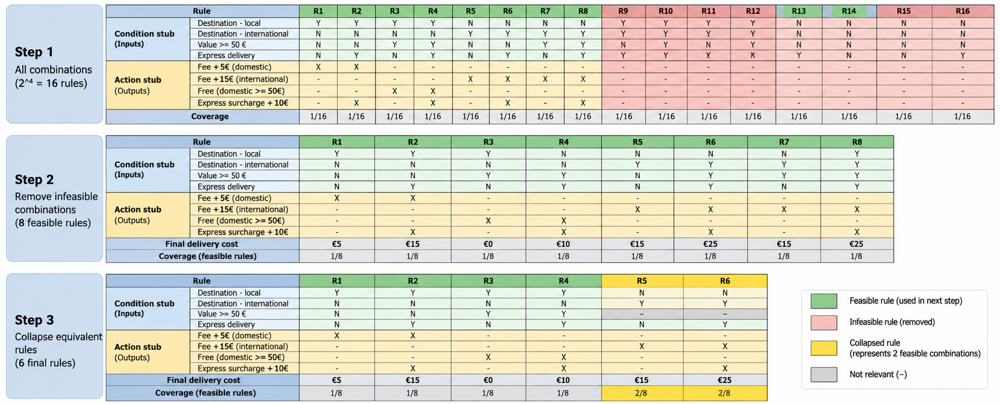

# Apply Decision Table Testing on Toolshop

## Syllabus Reference
ISTQB Foundation Level – **4.2.3 Decision Table Testing**

## Transfer Task
**Task:** [Apply Decision Table Testing on Toolshop ](https://github.com/rgroetz2/TBLL-AgileEngineeringFoundation/blob/main/courses/TestBusters-LearningLab/ISTQB-2026/foundationLevel/transferTasks/Chapter%204/ISTQB-FL-4.2.3_Decision_Table_Testing_20260405.md)     
**System Under Test:** [Toolshop](https://practicesoftwaretesting.com/)  
**Documentation:** [Toolshop documentation](https://github.com/testsmith-io/practice-software-testing/tree/main/docs)  
**Requirement source:** [delivery-costs-ISTQBFL](https://github.com/rgroetz2/TBLL-AgileEngineeringFoundation/blob/main/courses/TestBusters-LearningLab/ISTQB-2026/foundationLevel/transferTasks/delivery-costs-ISTQBFL.md)  

> **Scope note:** These delivery prices and rules are **proposed requirements**, not verified behavior of the live Toolshop application. The artifact below is a **test design**, not an execution report.

## Outcome

### 1. Objective and Scope

Apply **Decision Table Testing** to the proposed delivery-cost calculation rules. Model four Boolean conditions, identify infeasible combinations, collapse rules with identical outcomes, and derive concrete test cases.

### 2. Requirements and Assumptions

- **AC1 – Standard delivery:** Domestic base fee = **€5**; international base fee = **€15**.
- **AC2 – Free standard delivery:** For **domestic** orders with merchandise subtotal **≥ €50**, waive the €5 base fee.
- **AC3 – Express delivery:** When express delivery is selected, add **€10** to the applicable delivery charge, whether the order is domestic or international and whether or not the standard base fee was waived.

**Assumptions:**
- Every order has **exactly one** destination: local (domestic) or international.
- `Y` = Yes, `N` = No, `–` = don't care, `X` = action applies, `IF` = infeasible.
- The €50 threshold applies to the **merchandise subtotal**, not the subtotal including delivery.
- Delivery cost is the applicable base fee after any waiver, **plus** the express surcharge when selected.
- The table models requirements only; actual application behavior has not been tested.

**Four parts of a decision table (ISTQB):**

- **Condition stub:** the conditions being evaluated (left-hand labels in the upper part).
- **Condition entries:** the values of those conditions for each rule (`Y`, `N`, or `–`).
- **Action stub:** the resulting actions (left-hand labels in the lower part).
- **Action entries:** whether an action applies for each rule (`X` or `–`).

In the Markdown tables below, the **Section** column explicitly labels the condition and action stubs. The rule columns to their right contain the corresponding **condition entries** and **action entries**. Final fee, feasibility, and coverage are supplementary result/analysis rows, not additional conditions or actions.

### 3. Decision Table Design - Overview

The following diagram shows how the decision table was reduced from 16 combinations to 8 feasible combinations and finally to 6 collapsed rules.

### 3. Step 1 — Full Decision Table (16 Theoretical Combinations)

There are four Boolean conditions, so the initial table contains **2⁴ = 16** combinations. Each original column represents **1/16 = 6.25%** of the theoretical combination space. The table below uses a consistent binary ordering. Combinations where Local and International are both `Y` or both `N` are infeasible.

| **Section** | **Condition / Action** | R01 | R02 | R03 | R04 | R05 | R06 | R07 | R08 | R09 | R10 | R11 | R12 | R13 | R14 | R15 | R16 |
|---|---|---|---|---|---|---|---|---|---|---|---|---|---|---|---|---|---|
| **Condition stub** | **Local destination** | Y | Y | Y | Y | Y | Y | Y | Y | N | N | N | N | N | N | N | N |
| **Condition stub** | **International destination** | Y | Y | Y | Y | N | N | N | N | Y | Y | Y | Y | N | N | N | N |
| **Condition stub** | **Subtotal ≥ €50** | Y | Y | N | N | Y | Y | N | N | Y | Y | N | N | Y | Y | N | N |
| **Condition stub** | **Express delivery** | Y | N | Y | N | Y | N | Y | N | Y | N | Y | N | Y | N | Y | N |
| **Action stub** | **Base fee +€5** | – | – | – | – | – | – | X | X | – | – | – | – | – | – | – | – |
| **Action stub** | **Base fee +€15** | – | – | – | – | – | – | – | – | X | X | X | X | – | – | – | – |
| **Action stub** | **Base fee waived** | – | – | – | – | X | X | – | – | – | – | – | – | – | – | – | – |
| **Action stub** | **Express surcharge +€10** | – | – | – | – | X | – | X | – | X | – | X | – | – | – | – | – |
| **Result / coverage** | **Final delivery cost** | IF | IF | IF | IF | €10 | €0 | €15 | €5 | €25 | €15 | €25 | €15 | IF | IF | IF | IF |
| **Result / coverage** | **Feasibility** | IF | IF | IF | IF | Yes | Yes | Yes | Yes | Yes | Yes | Yes | Yes | IF | IF | IF | IF |
| **Result / coverage** | **Theoretical coverage per rule** | 1/16 | 1/16 | 1/16 | 1/16 | 1/16 | 1/16 | 1/16 | 1/16 | 1/16 | 1/16 | 1/16 | 1/16 | 1/16 | 1/16 | 1/16 | 1/16 |

**Step 1 result:** 16 theoretical combinations = **8 feasible + 8 infeasible**. Infeasible combinations are not executable test cases. Coverage here refers to the **theoretical condition space**, not test execution.

### 4. Step 2 — Remove Infeasible Combinations (8 Feasible Rules)

Remove original rules **R01–R04** (both destinations selected) and **R13–R16** (neither destination selected). Rename the eight remaining combinations **F1–F8**.

| **Section** | **Condition / Action** | F1 | F2 | F3 | F4 | F5 | F6 | F7 | F8 |
|---|---|---|---|---|---|---|---|---|---|
| **Result / coverage** | **Original rule** | R05 | R06 | R07 | R08 | R09 | R10 | R11 | R12 |
| **Condition stub** | **Local destination** | Y | Y | Y | Y | N | N | N | N |
| **Condition stub** | **International destination** | N | N | N | N | Y | Y | Y | Y |
| **Condition stub** | **Subtotal ≥ €50** | Y | Y | N | N | Y | Y | N | N |
| **Condition stub** | **Express delivery** | Y | N | Y | N | Y | N | Y | N |
| **Action stub** | **Base fee +€5** | – | – | X | X | – | – | – | – |
| **Action stub** | **Base fee +€15** | – | – | – | – | X | X | X | X |
| **Action stub** | **Base fee waived** | X | X | – | – | – | – | – | – |
| **Action stub** | **Express surcharge +€10** | X | – | X | – | X | – | X | – |
| **Result / coverage** | **Final delivery cost** | **€10** | **€0** | **€15** | **€5** | **€25** | **€15** | **€25** | **€15** |
| **Result / coverage** | **Feasible-space coverage per rule** | 1/8 | 1/8 | 1/8 | 1/8 | 1/8 | 1/8 | 1/8 | 1/8 |

**Step 2 result:** **8/8 = 100%** of feasible condition combinations are represented. Each feasible rule represents **1/8 = 12.5%** of that space.

### 5. Step 3 — Identify Rules That Can Be Collapsed

For international deliveries, the €50 threshold does **not** change the delivery fee. Therefore:

| Merge | Feasible rules | Shared conditions | Condition replaced by `–` | Expected fee | Feasible combinations represented | Coverage |
|---|---|---|---|---:|---:|---:|
| M1 | F5 + F7 | International = Y; Express = Y | Subtotal ≥ €50 | €25 | 2 | **2/8 = 25%** |
| M2 | F6 + F8 | International = Y; Express = N | Subtotal ≥ €50 | €15 | 2 | **2/8 = 25%** |

The four domestic rules **F1–F4** cannot be merged in the same way because the €50 threshold changes the domestic base fee.

**Step 3 result:** 8 feasible combinations become **6 collapsed rules**: 4 domestic rules plus 2 international rules.

### 6. Step 4 — Final Collapsed Decision Table (6 Rules)

A dash (`–`) in a **condition row** means the condition is irrelevant to that rule. In the **action rows**, `X` means the action applies; `–` means it does not.

| **Section** | **Condition / Action** | C1 | C2 | C3 | C4 | C5 | C6 |
|---|---|---|---|---|---|---|---|
| **Result / coverage** | **Derived from** | F1 | F2 | F3 | F4 | F5 + F7 | F6 + F8 |
| **Condition stub** | **Local destination** | Y | Y | Y | Y | N | N |
| **Condition stub** | **International destination** | N | N | N | N | Y | Y |
| **Condition stub** | **Subtotal ≥ €50** | Y | Y | N | N | – | – |
| **Condition stub** | **Express delivery** | Y | N | Y | N | Y | N |
| **Action stub** | **Base fee +€5** | – | – | X | X | – | – |
| **Action stub** | **Base fee +€15** | – | – | – | – | X | X |
| **Action stub** | **Base fee waived** | X | X | – | – | – | – |
| **Action stub** | **Express surcharge +€10** | X | – | X | – | X | – |
| **Result / coverage** | **Final delivery cost** | **€10** | **€0** | **€15** | **€5** | **€25** | **€15** |
| **Result / coverage** | **Feasible combinations covered** | 1 | 1 | 1 | 1 | 2 | 2 |
| **Result / coverage** | **Feasible-space coverage per rule** | **1/8** | **1/8** | **1/8** | **1/8** | **2/8** | **2/8** |

**Final coverage:** (1 + 1 + 1 + 1 + 2 + 2) / 8 = **8/8 = 100% of feasible combinations represented**. The six columns are **not equally weighted**: each international collapsed rule represents two original feasible combinations.

> **Coverage clarification:** These percentages describe **condition-combination representation**, not executed test coverage. If one test is selected for each collapsed rule, the test suite has **6/6 collapsed-rule coverage**, but it directly executes only **6/8 distinct feasible input combinations**. The remaining two combinations are represented logically by the don't-care conditions, not individually executed.

### 7. Derived Test Cases

Select one representative test case per final collapsed rule. For the international don't-care rules, choose a subtotal on either side of €50; the same expected delivery fee applies to both sides according to AC1–AC3.

| Test ID | Final rule | Destination | Merchandise subtotal | Delivery speed | Expected calculation | Expected delivery cost | Execution status |
|---|---|---|---:|---|---|---:|---|
| TC-DT-01 | C1 | Local | €50.00 | Express | €0 + €10 | **€10.00** | Not executed |
| TC-DT-02 | C2 | Local | €50.00 | Standard | €0 | **€0.00** | Not executed |
| TC-DT-03 | C3 | Local | €49.99 | Express | €5 + €10 | **€15.00** | Not executed |
| TC-DT-04 | C4 | Local | €49.99 | Standard | €5 | **€5.00** | Not executed |
| TC-DT-05 | C5 | International | €70.00 | Express | €15 + €10 | **€25.00** | Not executed |
| TC-DT-06 | C6 | International | €30.00 | Standard | €15 | **€15.00** | Not executed |

**Test design coverage:** 6/6 collapsed rules selected. **Execution coverage:** 0/6, because execution is not part of the supplied task instructions and no results have been provided.

**Optional additional checks:** To demonstrate both sides of the international subtotal don't-care condition directly, also execute international express at €30 and international standard at €70. This would exercise all eight feasible combinations rather than relying only on collapsed-rule reasoning.

### 8. Risk, Quality Impact, and Follow-up

**Risks addressed:**
- Applying the domestic free-delivery threshold to international orders by mistake.
- Charging €5 for a domestic order at exactly €50.
- Forgetting the €10 express surcharge when the domestic base fee is waived.
- Treating local and international destinations as simultaneously selectable or leaving the destination undefined.

**Quality impact:** The table makes combinations of destination, subtotal threshold, and delivery speed explicit. It helps the team review the proposed calculation logic before implementation or execution.

**Follow-up:** Confirm the proposed requirements with the Product Owner, especially whether exactly one destination is mandatory. Execute the derived tests when the delivery-cost feature is available and record actual results separately.

### Learning Summary ###

Decision Table Testing is a **black-box test design technique** used when a system's behavior depends on combinations of conditions.

I started with **four Boolean conditions**, giving **16 theoretical combinations**. I removed **eight infeasible combinations** because an order must have exactly one destination. Then I collapsed the international rules where the merchandise subtotal does not affect the fee, reducing the table from **eight feasible combinations to six final rules**.

I learned that **removing infeasible combinations** is different from **collapsing equivalent rules**. I also learned that coverage values must be interpreted carefully: in the final table, a collapsed rule can represent **2/8** of the feasible combinations, while an uncollapsed rule represents **1/8**.

The final result is a decision table and six derived test cases that the Scrum team can use to review and test the proposed delivery-cost rules.
